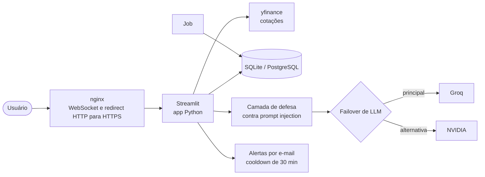
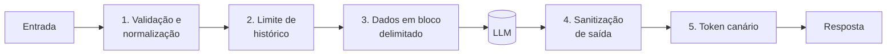

# Invest System

**Rebalanceamento de carteira com defesa em camadas contra prompt injection**

> **Aviso.** Este repositório é uma vitrine. O código do Invest System é **privado**. Esta página descreve o que foi construído, usando apenas fatos que consigo sustentar.

## O que é

Projeto **próprio** do Gabriel, que ganhou outra proporção ao ser integrado à disciplina de **Métodos Ágeis** (UMC), feito **em dupla**, com Gabriel como **Product Owner**. A integração trouxe atualizações, alertas por e-mail e a subida para uma VPS com auxílio do professor. O sistema ajuda no **rebalanceamento de carteira**. Foi **aprovado na 4ª edição do UMC Summit (categoria Inovação)**.

Método: **Scrum**, com sprints semanais, backlog, Definition of Done e revisão por Pull Request.

## Arquitetura

Deploy com Docker Compose (app, PostgreSQL e job), nginx e certbot em uma VPS. O HTTPS está **configurado**, mas o certificado ainda não foi emitido.

## Defesa contra prompt injection

| Camada | O que faz |
|---|---|
| Validação de entrada | Valida e normaliza o que o usuário envia |
| Limite de histórico | Restringe quanto contexto anterior entra no prompt |
| Dados em bloco delimitado | Separa dados do usuário das instruções |
| Sanitização de saída | Limpa a resposta antes de exibir |
| Token canário | Detecta vazamento do prompt |

**Resultado em testes:** 31 de 40 tentativas de contorno bloqueadas e **0 de 37** perguntas legítimas recusadas. Ou seja, 9 contornos ainda passam. A defesa reduz o risco, não o elimina.

## Outros recursos

| Recurso | Detalhe |
|---|---|
| Failover entre provedores de LLM | Groq e NVIDIA, acionado por erro de rede, limite 429 e erro 5xx |
| Alertas por e-mail | Com cooldown de 30 minutos |
| Importação CSV | Com proteção contra injeção de fórmula |
| Telemetria | A telemetria de terceiros do Streamlit foi investigada e desligada |
| Banco | Suporte a PostgreSQL, verificado em SQLite |
| Qualidade | 285 testes pytest, CI no GitHub Actions |

## O que está provado e o que ainda não foi

| O que está provado | O que ainda não foi provado |
|---|---|
| 285 testes pytest | Chat com Groq e NVIDIA reais (os testes usam cliente simulado) |
| 31 de 40 contornos bloqueados, 0 de 37 perguntas legítimas recusadas | Emissão real do certificado HTTPS (nginx e certbot estão **configurados**) |
| Alertas com cooldown e importação CSV cobertos por testes | PostgreSQL rodando de fato (verificado só em SQLite) |
| Aprovação na 4ª edição do UMC Summit | Uso por pessoas reais |

## Como foi feito

Trabalho em dupla, com **IA generativa (Claude Code)** usada com disciplina de engenharia: revisão por Pull Request, testes e Definition of Done.

## Autor

Gabriel Nagatani Campos, autor do projeto e Product Owner na disciplina. [Portfólio](https://gabrielnagatanicampos.github.io)
