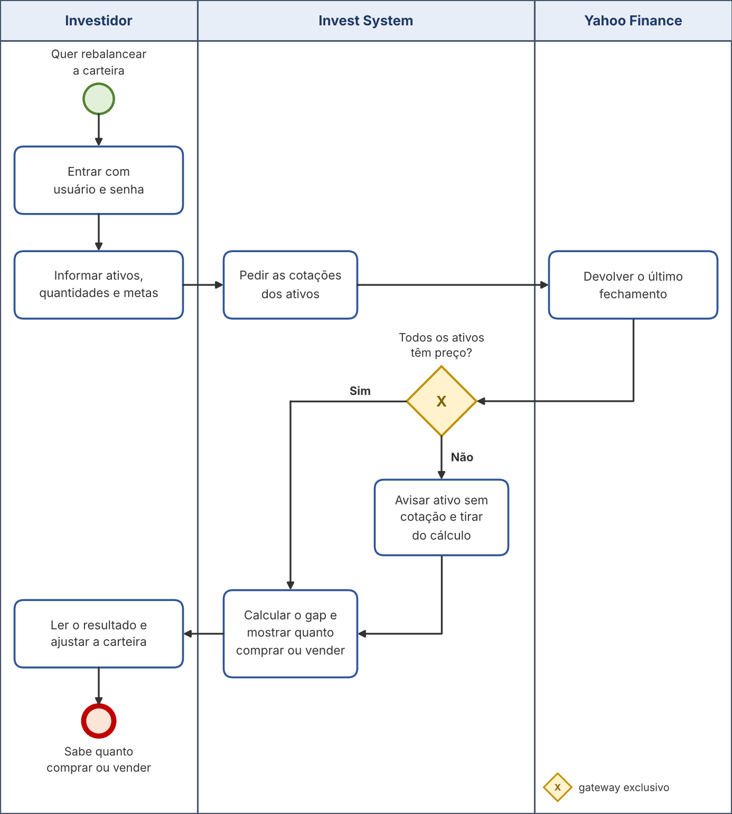
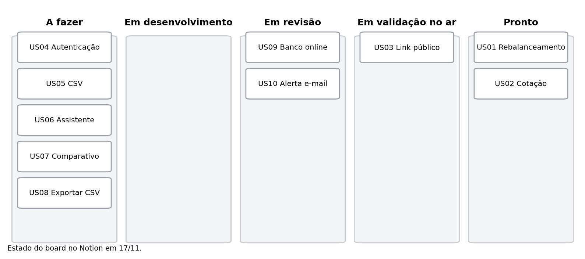

# Invest System: Smart Portfolio Management & Data Pipeline

**Calcula quanto comprar ou vender de cada ativo para a carteira voltar às metas do investidor.**

> O código é privado. Esta página mostra o que foi construído e qual foi o meu papel, só com o que consigo comprovar.

## Como nasceu

O Invest System é um projeto **meu**, que comecei antes de qualquer entrega de disciplina (o histórico no Git tem commits desde setembro). Na disciplina de Métodos Ágeis da UMC, em dupla, usei o projeto como alavanca para quatro coisas: ampliar as funcionalidades, ganhar visão de negócio, levar o sistema para a internet (numa VPS, com auxílio do professor) e praticar metodologias ágeis na prática.

Com esse trabalho, fui selecionado para a **4ª edição do UMC Summit, na categoria Inovação**.

Meu papel: **Product Owner**. O Scrum Master do time foi meu colega de dupla.

## O problema e a ideia

Os preços mudam todo dia, e aos poucos alguns ativos passam a pesar mais ou menos do que a meta do investidor. Descobrir quanto comprar ou vender de cada um exige planilha e conta manual. Quem não tem o valor mínimo exigido pelas gestoras acaba fazendo isso sozinho, muitas vezes sem entender o que está comprando.

O público é quem investe por conta própria e está começando. O sistema pega as cotações do dia e diz, em reais, quanto comprar ou vender de cada ativo.

## Valor para o negócio

- O investidor deixa a planilha de lado e vê a conta pronta.
- O assistente explica a carteira em linguagem simples, sem recomendar compra nem venda.
- Alertas por e-mail avisam quando a carteira se afasta da meta (testados com servidor fictício).
- Cada usuário enxerga só a própria carteira.

## Como o sistema decide

Se algum ativo não tem cotação, o sistema avisa o nome dele e o tira do cálculo, em vez de mostrar um número errado.

## O que eu fiz neste projeto

- Levantei os requisitos e as regras de negócio e escrevi as histórias de usuário com critérios de aceite.
- Priorizei o backlog como Product Owner e defini o que significa "pronto".
- Modelei os dados da carteira, dos usuários e dos alertas.
- Orientei e revisei o trabalho da IA, que escreveu boa parte do código.
- Levei o projeto para a internet, numa VPS.

> Boa parte do código foi construída com apoio de IA generativa, e os testes automáticos também (285 testes, revisados por mim); eu defino o que o sistema precisa fazer e reviso o resultado.

## Gestão ágil na prática

| Prática | Como usamos |
|---|---|
| Histórias de usuário | 10 histórias, cada uma com critérios de aceite que se respondem com sim ou não |
| Sprints | Sprints semanais (2 executadas, a 3ª está planejada) |
| Definition of Ready | História no formato Como/Quero/Para, critérios escritos, pontuada e cabendo em uma sprint |
| Definition of Done | Critérios cumpridos, testes passando, Pull Request revisado por outro integrante e publicado no link (na Sprint 2, nenhuma história chegou ao fim da Definition of Done) |
| Kanban | 5 colunas, com limite de trabalho em andamento (2 em desenvolvimento, 1 em revisão, 1 em validação) |
| Retrospectiva | Começar, Parar, Continuar |
| Pull Request | Regra do time: Pull Request revisado por outro integrante (quem escreve não aprova o próprio) |

Veja o resumo completo em [docs/documentacao-agil.md](docs/documentacao-agil.md).

## Como organizamos o trabalho

*Quadro no fim da primeira semana (17/11), com as histórias nas cinco colunas.*

## O que foi difícil e como resolvemos

**Ativos sem preço.** Alguns ativos apareciam sem cotação. A IA levantou hipóteses (fusão de empresas, mudança de nome), mas os dados não provavam nenhuma. Mantive só o que foi conferido: 8 códigos tinham mudado e o novo tinha preço; 8 deixaram de existir. Hoje o sistema avisa na tela quando falta cotação.

**O chat respondia erro até para "oi".** A integração com o provedor de IA tinha sido aprovada só com um cliente simulado, sem nenhuma chamada real. Quando rodou de verdade, o provedor recusava a chamada. Corrigimos e criamos uma regra: toda integração externa precisa de pelo menos uma chamada real antes de ser aprovada.

**Quantidade do CSV sem limite máximo.** Na importação de carteira, um número gigante na coluna de quantidade quebraria a gravação no banco. Achei na revisão, e a importação passou a recusar valores acima do limite.

## Estado atual

| Já funciona | Ainda não |
|---|---|
| Versão da Sprint 1 (rebalanceamento com cotações) implantada numa VPS | Login, importação de CSV, assistente da carteira, banco online e alertas por e-mail estão implementados e testados, mas ainda não foram publicados na VPS |
| 285 testes automáticos (1 pulado e 1 esperado a falhar) | Alertas por e-mail testados só com servidor fictício, sem envio real |
| Suporte a PostgreSQL no código | PostgreSQL verificado só em SQLite |
| HTTPS configurado | Certificado ainda não emitido, e ainda sem domínio |
| Verificações automáticas a cada alteração | Publicação automática pendente |

Stack: Python, Streamlit, SQLite e PostgreSQL, Docker Compose, nginx e GitHub Actions.

## Autor

Gabriel Nagatani Campos, estudante de Engenharia de Software (UMC). [Portfólio](https://gabrielnagatanicampos.github.io)
